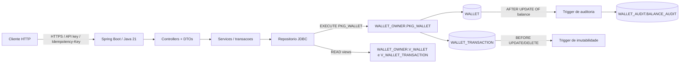
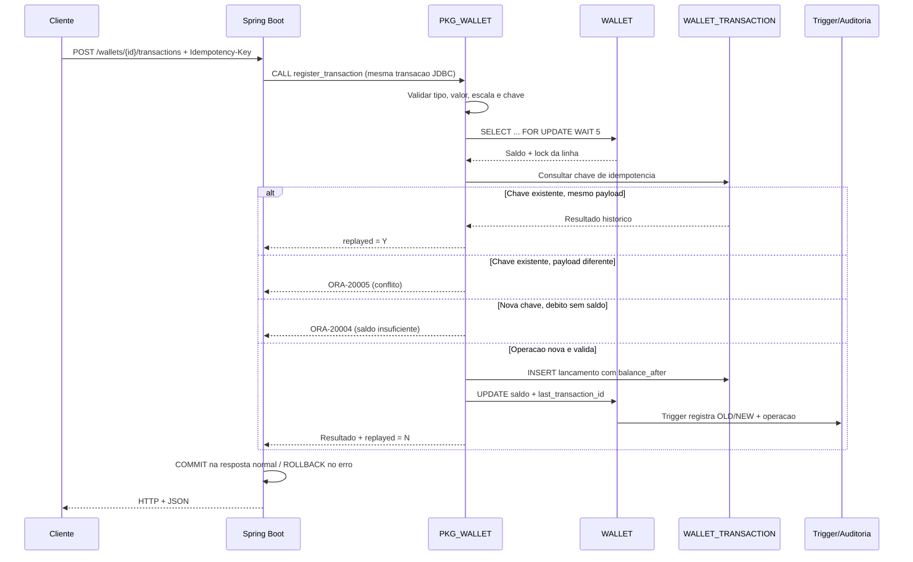

# Wallet API — Arquitetura da Solucao

> Status: proposta de arquitetura para orientar a implementacao. O diagrama editavel esta em [`docs/diagrams/wallet-architecture.excalidraw`](diagrams/wallet-architecture.excalidraw).
>
> Fonte: teste tecnico **Servico de Carteira Digital (Wallet API)**. Decisoes e premissas complementares estao em [`DECISIONS.md`](../DECISIONS.md).

## 1. Objetivo, escopo e invariantes

A Wallet API oferece uma interface HTTP para criar carteiras BRL, consultar saldo, aplicar creditos/debitos e consultar extratos. A **consistencia financeira e assegurada no Oracle**, nao apenas no Java.

Invariantes a demonstrar por testes:

- **INV-01**: cada carteira comeca com saldo `0.00` BRL e `balance >= 0` em todos os estados confirmados.
- **INV-02**: valores de operacoes sao positivos e possuem no maximo duas casas decimais.
- **INV-03**: um lancamento aplicado produz exatamente **uma** atualizacao de saldo e **uma** entrada de auditoria correspondente, na mesma transacao.
- **INV-04**: uma operacao aplicada nao pode ser aplicada novamente com a mesma chave de idempotencia. Mesmo payload => replay do resultado original; payload diferente => conflito.
- **INV-05**: lancamentos financeiros confirmados nao aceitam `UPDATE` ou `DELETE` via DML, inclusive executado diretamente no banco por usuarios nao privilegiados.
- **INV-06**: sob operacoes concorrentes na mesma carteira, o saldo confirmado corresponde a soma dos creditos e debitos efetivamente aplicados.
- **INV-07**: a aplicacao conecta somente como `WALLET_APP`, sem DML direto nas tabelas de negocio ou acesso ao schema de auditoria.

**Fora de escopo:** UI, multiplas moedas, cambio, juros, JWT/OAuth para usuarios finais, agendamento, estorno, chargeback e transferencia entre carteiras no nucleo obrigatorio.

## 2. Visao de componentes



Responsabilidades:

| Camada | Responsabilidade | Nao deve fazer |
|---|---|---|
| HTTP / controllers | Expor rotas, validar formato, devolver status e DTOs | SQL e decisao definitiva sobre saldo |
| Service | Orquestrar casos de uso e limites de transacao (`@Transactional`) | Reimplementar o debito financeiro |
| JDBC repository | Chamar package PL/SQL, ler views e mapear resultados | Escrever diretamente nas tabelas |
| Oracle PL/SQL | Validacoes definitivas, concorrencia, idempotencia, saldo e extrato | Autenticacao HTTP |
| Constraints / triggers | Barreiras de integridade, extrato imutavel e auditoria | Substituir a orquestracao do package |
| Flyway / init | Versionar e reproduzir estruturas, permissoes e objetos | Executar como `WALLET_APP` em producao |

## 3. Schemas e privilegios

| Schema | Funcao | Privilegios relevantes |
|---|---|---|
| `WALLET_OWNER` | Possui tabelas, sequences, views, package e triggers; utilizado pelas migrations | Criacao de objetos, `INSERT` em `WALLET_AUDIT.BALANCE_AUDIT` e permissao necessaria na sequence de auditoria |
| `WALLET_APP` | Usuario do pool JDBC da aplicacao | `CREATE SESSION`, `EXECUTE` no package e `READ` nas views; sem `INSERT/UPDATE/DELETE` nas tabelas |
| `WALLET_AUDIT` | Possui tabela e sequence da trilha de auditoria | Cria objetos de auditoria; concede apenas escrita necessaria para `WALLET_OWNER` |

O package usa `AUTHID DEFINER`, para executar com os privilegios do `WALLET_OWNER`. Grants entre schemas devem ser diretos; roles nao substituem grants diretos em objetos PL/SQL do tipo definer-rights. Senhas jamais serao versionadas.

## 4. Modelo de dados

### `WALLET_OWNER.WALLET`

| Campo | Tipo proposto | Restricao / significado |
|---|---|---|
| `id` | `NUMBER(19)` | PK; `SEQ_WALLET.NEXTVAL` |
| `holder_name` | `VARCHAR2(200 CHAR)` | Opcional |
| `balance` | `NUMBER(19,2)` | `NOT NULL DEFAULT 0`, `CHECK(balance >= 0)` |
| `last_transaction_id` | `NUMBER(19)` | FK opcional para ultima transacao; auxilia correlacao na auditoria |
| `created_at`, `updated_at` | `TIMESTAMP WITH TIME ZONE` | Instantes da carteira |

### `WALLET_OWNER.WALLET_TRANSACTION`

| Campo | Tipo proposto | Restricao / significado |
|---|---|---|
| `id` | `NUMBER(19)` | PK; `SEQ_WALLET_TRANSACTION.NEXTVAL` |
| `wallet_id` | `NUMBER(19)` | FK `WALLET.id` |
| `transaction_type` | `VARCHAR2(6)` | `CREDIT` ou `DEBIT` |
| `amount` | `NUMBER(19,2)` | `CHECK(amount > 0)`; escala validada antes de gravar |
| `balance_after` | `NUMBER(19,2)` | Saldo historico da operacao; usado no replay |
| `idempotency_key` | `VARCHAR2(100 CHAR)` | Obrigatoria; `UNIQUE` global |
| `created_at` | `TIMESTAMP WITH TIME ZONE` | Instante do lancamento |

Indice proposto: `(wallet_id, created_at, id)` para consultas de extrato e indexacao da FK. A FK de `last_transaction_id` pode ser criada em etapa posterior as duas tabelas para resolver a dependencia circular.

### `WALLET_AUDIT.BALANCE_AUDIT`

Campos: `id`, `wallet_id`, `transaction_id` (nullable), `old_balance`, `new_balance`, `changed_at`, `db_user`. A auditoria reside em schema independente e **nao e acessivel por `WALLET_APP`**.

A correlacao por `last_transaction_id` requer cuidado: se a atualizacao nao mudou esse ID, a trigger deve registrar `transaction_id = NULL`, em vez de associar falsamente o evento a uma operacao anterior. Mesmo assim, um proprietario/admin privilegiado pode contornar certas protecoes; documentado em `DECISIONS.md`.

## 5. Contrato do package PL/SQL

```sql
CREATE OR REPLACE PACKAGE wallet_owner.pkg_wallet AUTHID DEFINER AS
    PROCEDURE create_wallet(
        p_holder_name IN VARCHAR2,
        o_wallet_id   OUT NUMBER,
        o_balance     OUT NUMBER,
        o_created_at  OUT TIMESTAMP WITH TIME ZONE
    );

    PROCEDURE register_transaction(
        p_wallet_id       IN NUMBER,
        p_idempotency_key IN VARCHAR2,
        p_type            IN VARCHAR2,
        p_amount          IN NUMBER,
        o_transaction_id  OUT NUMBER,
        o_balance_after   OUT NUMBER,
        o_created_at      OUT TIMESTAMP WITH TIME ZONE,
        o_replayed        OUT VARCHAR2
    );
END pkg_wallet;
/
```

O package **nao executa `COMMIT`**. A aplicacao delimita a transacao JDBC com `@Transactional`; em erro propagado, precisa acionar rollback. O banco valida tipo, valor positivo, escala monetaria, idempotency key e saldo disponivel; validações no Java sao complementares, nao substitutas.

## 6. Fluxo de registro de credito / debito



A linha da carteira e bloqueada ate `COMMIT`/`ROLLBACK`. Uma segunda operacao sobre a mesma carteira precisa adquirir o lock e trabalhar com o saldo mais recente confirmado. Cada procedure trava **uma carteira**, evitando lock em varias carteiras no fluxo principal.

### Cenarios de concorrencia obrigatorios

1. **Duas chaves diferentes, mesma carteira:** saldo 50 e dois debitos de 30 => um aplicado e outro rejeitado; saldo final 20.
2. **Mesma chave e payload, mesma carteira:** somente uma operacao aplicada; segundo retorno e replay.
3. **Mesma chave, payload diferente:** erro de conflito; nenhuma segunda operacao aplicada.
4. **Mesma chave em carteiras diferentes:** o lock por carteira nao basta; a restricao `UNIQUE` global deve ser tratada no package.
5. **Timeout de lock:** retorna erro transitorio; cliente pode tentar novamente com a mesma chave.

**Ponto em aberto importante:** o design acima persiste apenas operacoes **aplicadas**. A prova de idempotencia para uma operacao rejeitada e repetida apos o saldo mudar ainda exige definicao explicita (ver DEC-09). Nao afirmar cobertura desse caso sem implementacao e teste.

## 7. Endpoints HTTP e erros

| Metodo | Rota | Comportamento |
|---|---|---|
| `POST` | `/wallets` | `201 Created`; identificador e saldo 0.00; `Location` |
| `GET` | `/wallets/{id}` | `200 OK`; carteira e saldo ou `404` |
| `POST` | `/wallets/{id}/transactions` | Header `Idempotency-Key`, corpo `{type,amount}`; `201`; em replay, mesmo resultado historico e header `Idempotent-Replayed: true` |
| `GET` | `/wallets/{id}/transactions` | `200`; `page`, `size`, `from`, `to` (to exclusivo); ordenacao `created_at DESC, id DESC` |

Autenticacao de sistema: header `X-API-Key` (sem JWT/OAuth). Formato de erro consistente: `{code, message, status, timestamp}` (nao expor detalhes Oracle ao cliente).

| Codigo PL/SQL | HTTP | Codigo da API |
|---|---:|---|
| `-20001` | 400 | `INVALID_AMOUNT` |
| `-20002` | 400 | `INVALID_TRANSACTION_TYPE` |
| `-20003` | 404 | `WALLET_NOT_FOUND` |
| `-20004` | 422 | `INSUFFICIENT_FUNDS` |
| `-20005` | 409 | `IDEMPOTENCY_KEY_CONFLICT` |
| `-20006` | 503 | `WALLET_BUSY` (considerar `Retry-After`) |
| `-20007` | 400 | `INVALID_IDEMPOTENCY_KEY` |
| `-20008` | 400 | `INVALID_HOLDER_NAME` |
| Outros | 500 | `INTERNAL_ERROR` (sem vazar Oracle) |

## 8. Ambiente e entrega

- **Docker Compose:** Oracle Database Free (`gvenzl/oracle-free`) com **tag fixa**, healthcheck, volume e senhas por variaveis de ambiente. Conectar no PDB `FREEPDB1`.
- **Bootstrap versionado:** criar os tres usuarios e seus privilegios minimos.
- **Migrations Flyway:** uma etapa para `WALLET_AUDIT` e outra para `WALLET_OWNER`; `WALLET_APP` nunca executa DDL.
- **API:** Java 21 + Spring Boot, Maven, Spring Web, Validation, Spring JDBC, OpenAPI e API key.
- **Testes:** unitarios (especialmente mapeamento Oracle/HTTP) e integracao com **Oracle real** (Testcontainers recomendado), incluindo concorrencia, retry e auditoria.
- **Segredos:** `.env` ignorado pelo Git; fornecer `.env.example` sem valores reais em commit futuro.

## 9. Plano de implementacao

1. C01 — Bootstrap Spring Boot.
2. **C02 — Arquitetura, diagrama editavel e decisoes tecnicas (este commit).**
3. C03 — Oracle Docker Compose + healthcheck.
4. C04 — Bootstrap de schemas e Flyway.
5. C05 — Modelo relacional, sequences e views.
6. C06 — Package: criacao de carteira.
7. C07 — Package: credito/debito, transacao e locks.
8. C08 — Idempotencia, triggers e auditoria.
9. C09 — Integracao JDBC, endpoints HTTP e erros.
10. C10 — Testes unitarios e de integracao com concorrencia.
11. C11 — OpenAPI, README de execucao e revisao final.
12. C12 (opcional) — Teste de carga ou outra melhoria, somente depois do nucleo.

> **Criterio de aceite de C02:** a equipe consegue explicar a separacao Java/Oracle, o modelo de dados, por que o saldo nao fica negativo, como o retry funciona e quais decisoes estao abertas — sem executar codigo adicional.
